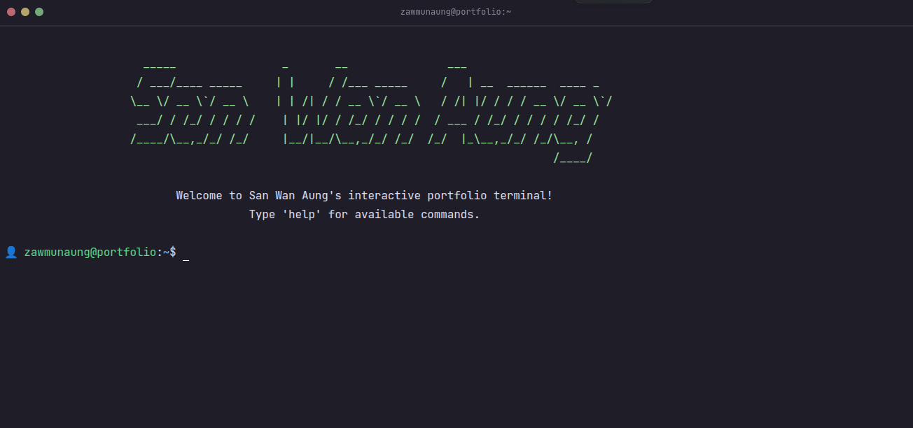

# San Wan Aung — Interactive Terminal Portfolio

[](https://sanwanaungportfolio.vercel.app/)
[](https://nextjs.org)
[](https://react.dev)
[](https://www.typescriptlang.org)
[](https://tailwindcss.com)

> A polished, terminal-inspired developer portfolio built with Next.js, React, and xterm.js.

**Website:** [sanwanaungportfolio.vercel.app](https://sanwanaungportfolio.vercel.app/)  
**Author:** [San Wan Aung](https://github.com/sanwanaung)



## Overview

This portfolio replaces a conventional landing page with an interactive terminal experience. Visitors can explore San Wan Aung's profile, technical skills, projects, education, social links, and contact details using commands or the visible macOS-style interface.

The project is a responsive, client-rendered Next.js application with boot animations, theme switching, terminal history, command autocomplete, ASCII banners, external-link handling, and terminal-compatible image rendering.

## Highlights

- Interactive **xterm.js 6** terminal
- Command registry with aliases and fuzzy suggestions
- Up/down arrow command history
- Tab autocomplete
- Responsive ASCII identity banners
- Animated boot sequence
- Light, dark, and system themes
- macOS-inspired window chrome
- Terminal commands for profile, skills, projects, education, and contact information
- Terminal-rendered project previews
- Custom 404 page with the same visual language
- SEO metadata, Open Graph, Twitter cards, and resume access

## Tech Stack

| Area | Technologies |
| --- | --- |
| Framework | Next.js 16 App Router, React 19 |
| Language | TypeScript |
| Styling | Tailwind CSS 4, shadcn/ui, CSS custom properties |
| Terminal | xterm.js, Fit, Clipboard, Image, and Web Links addons |
| Animation | Framer Motion, tw-animate-css |
| Theming | next-themes |
| UI | Lucide React, Base UI |
| Tooling | pnpm, ESLint 9 |

## Available Commands

| Command | Purpose |
| --- | --- |
| `help` | List available commands |
| `about` | Show the profile overview |
| `skills` | Display technical skills |
| `projects` | Browse featured projects |
| `education` | Show educational background |
| `contact` | Display contact details |
| `socials` | Open or list social profiles |
| `email` | Open the email composer |
| `echo` | Print text in the terminal |
| `clear` | Clear the terminal screen |

## Project Structure

```text
app/
├── layout.tsx          # Root layout, fonts, metadata, theme provider
├── page.tsx            # Main portfolio interface
├── globals.css         # Tailwind theme and terminal styles
└── not-found.tsx       # Custom terminal-style 404 page

config/
├── index.ts            # Profile, skills, projects, and boot content
└── site.ts             # Site identity and ASCII banners

features/
├── commands/           # Terminal command definitions and registry entries
├── components/         # Terminal runtime, frame, boot, and loading UI
├── lib/                # Command parsing, registration, and image helpers
└── theme/              # Theme toggle and terminal ANSI colors

components/ui/          # Shared shadcn-style UI components
lib/                    # Shared utility and xterm theme helpers
providers/              # next-themes provider
public/                 # Showcase images, favicon, and resume
types/                  # Shared TypeScript interfaces
```

## How It Works

The home page combines a profile panel with `TerminalRunTime`. After the boot sequence completes, `XtermTerminal` initializes the xterm.js instance and installs Fit, Clipboard, Image, and Web Links addons. Keyboard input is parsed and passed to the command registry, which resolves built-in commands and writes typed or structured output back to the terminal.

Portfolio content is centralized in `config/index.ts`, while identity metadata and responsive ASCII banners live in `config/site.ts`. This keeps the terminal experience independent from the underlying profile data.

## Getting Started

### Prerequisites

- Node.js 20 or newer
- pnpm

### Installation

```bash
git clone https://github.com/sanwanaung/portfolio.git
cd portfolio
pnpm install
pnpm dev
```

Open [http://localhost:3000](http://localhost:3000) in your browser.

## Scripts

| Command | Description |
| --- | --- |
| `pnpm dev` | Start the local development server |
| `pnpm build` | Create an optimized production build |
| `pnpm start` | Run the production server |
| `pnpm lint` | Run ESLint |

## Configuration

Update portfolio content in [`config/index.ts`](./config/index.ts):

- `portfolio.about`
- `portfolio.skills`
- `portfolio.projects`
- `portfolio.education`
- `portfolio.contact`
- `portfolio.socials`
- `badges`

Update site identity and terminal metadata in [`config/site.ts`](./config/site.ts).

No environment variables are required.

## Deployment

This project is ready for deployment on Vercel:

```bash
vercel
```

Alternatively, connect the GitHub repository to a Vercel project and use the default Next.js build settings.

## License

All rights reserved. © San Wan Aung.
